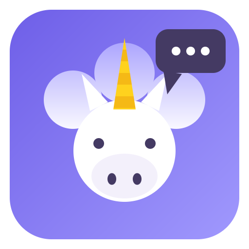

<p align="center">
  
</p>

<h1 align="center">UniChat</h1>

<p align="center">
  <strong>Alle deine KI-Chats in einer einzigen App.</strong>
</p>

<p align="center">
  
  
  
  
  
</p>

<p align="center">
  <a href="README.md">English</a> &nbsp;·&nbsp;
  <a href="README.fr.md">Français</a> &nbsp;·&nbsp;
  <strong>Deutsch</strong> &nbsp;·&nbsp;
  <a href="README.es.md">Español</a> &nbsp;·&nbsp;
  <a href="README.it.md">Italiano</a>
</p>

<p align="center">
  <strong>Download:</strong>
  <a href="https://github.com/Invenify/Unichat/releases">Releases</a>
</p>

---

## Das Konzept

Du nutzt ChatGPT, Claude, Gemini, Le Chat, Copilot… jeder in seinem eigenen
Tab, Fenster oder seiner App. **UniChat vereint sie alle in einer Oberfläche**:
Jeder Dienst öffnet sich in seiner eigenen Ansicht (Sitzung bleibt erhalten),
und alle deine Unterhaltungen erscheinen in einer gemeinsamen Seitenleiste.

Die goldene Regel des Projekts: **kein dienstspezifischer Code**. Morgen taucht
ein unbekannter KI-Chat auf? URL einfügen — er funktioniert sofort.

## Download

Installationsfertige Binärdateien auf der [Releases-Seite](https://github.com/Invenify/Unichat/releases):

| Plattform | Datei |
|---|---|
| Windows x64 | `UniChat Setup 0.2.0.exe` |
| Linux x64 | `UniChat-0.2.0.AppImage` |
| macOS arm64 | `UniChat-0.2.0-arm64-mac.zip` (unsigniert: beim ersten Start Rechtsklick → Öffnen) |
| Android | `UniChat-0.2.0.apk` (Debug-Build: unbekannte Quellen erlauben) |

## Funktionen

| | Funktion |
|---|---|
| **Dynamisches Register** | KI-Chat-URL einfügen: die App holt automatisch Name, Logo (Favicon) und Farben (theme-color, Manifest) — alles vor dem Speichern änderbar. |
| **Universelle Titel-Engine** | Bei jeder Navigation speichert die App `{Dienst, URL, Seitentitel, Datum}`. Die Seitenleiste entsteht aus diesem Verlauf — kein CSS-Selektor zu pflegen, der Seitentitel IST der Chattitel. |
| **Eingebauter Katalog** | 20 bekannte Dienste (ChatGPT, Claude, Gemini, Copilot, Duck.ai, Perplexity, Le Chat, Grok, DeepSeek, Euria, Lumo, Poe, Qwen, Kimi…) beim ersten Start angeboten, jederzeit an-/abwählbar (Sitzung und Verlauf bleiben). |
| **Weiterleitung & KI-Battle** | Prompt in UniChat eingeben (Strg/Cmd+P), eine KI (Weiterleitung) oder mehrere (Battle) wählen. Für jede KI wird der Prompt **automatisch eingefügt und gesendet** (simuliertes Enter); sobald die KI die Unterhaltung startet, übernimmt die nächste — null Handgriffe. 10-s-Ersatzlösung + ▶-Knopf, falls eine KI zickt. Gespeicherte Prompt-Bibliothek. Keine Seiten-Selektoren; der Prompt wird nie aus den Seiten gelesen. |
| **Geteilte Ansicht (Desktop)** | Zwei KIs nebeneinander (Strg/Cmd+E, dann Strg+Klick auf einen Dienst für die rechte Hälfte): Antworten vergleichen ohne Umschalten. |
| **Arbeitsbereiche** | Privat, Arbeit, Studium…: jeder Bereich ist eine Teilmenge deiner Dienste — **schnelles Umschalten über den Chip** (Desktop-Seitenleiste, Chats-Bildschirm mobil); Palette, Weiterleitung, Dock und Strg/Cmd+1…9 folgen dem aktiven Bereich, nicht angezeigte KIs werden in den Ruhezustand versetzt (Desktop). Verwaltung in den Einstellungen; Mitgliedschaft über ✎ des Dienstes (Desktop) oder ⋮-Menü (mobil). |
| **Mehrere Konten** | Dienst duplizieren (✎ → „Duplizieren“): komplett eigenständige Anmeldung (Le Chat privat + Arbeit). |
| **Freie Dienst-Reihenfolge** | Seitenleisten-Köpfe ziehen (Desktop) oder Dock (mobil, langes Drücken), um deine KIs zu ordnen — Euria und Euria Pro nebeneinander. Die Reihenfolge steuert auch Strg/Cmd+1…9. |
| **Universelle Palette** | Strg/Cmd+Tab: Unterhaltung über alle Dienste hinweg suchen (oder Dienst nach Namen) und mit einem Tastendruck öffnen — kein Rätselraten mehr, auf welcher Seite ein Chat lebt. |
| **Geräteübergreifendes Profil** | Dienste, Arbeitsbereiche, Einstellungen und Verlauf als JSON-Datei exportieren (`unichat-profile.json`) — **niemals die Sitzungen**. Android-Teilen mobil, native Dialoge am Desktop. Der Import überschreibt nichts; IDs werden per URL neu zugeordnet. |
| **Ressourcen** | „Ruhezustand“-Einstellung: seit X Minuten nicht angezeigte KIs werden in den Ruhezustand versetzt (Speicher freigegeben), per Klick auf ihrer letzten Seite aufgeweckt — Sitzung bleibt. Nie während eines Battles. |
| **Einstellungen & Sprachen** | Einstellungen (⚙ oder Strg/Cmd+,): Design, **Oberflächensprache** (Französisch, Englisch, Deutsch, Spanisch, Italienisch — folgt standardmäßig der Systemsprache), **Tracker-Blocker** in den Ansichten (Desktop), **Verlaufsaufbewahrung** (unbegrenzt / 30 / 90 Tage / 1 Jahr), Dienstverwaltung, Register-Export/-Import. Desktop und mobil. |
| **Tastenkürzel** | Strg/Cmd+1…9 Dienst, +K suchen, +P Weiterleitung/Battle, +N neuer Chat, +Tab Palette, +E geteilte Ansicht, +B Seitenleiste, +, Einstellungen, +/ die Kürzelliste — und Strg/Cmd+Alt+U, ein **systemweites Kürzel**: UniChat erscheint über jeder Anwendung, Palette offen. **Datei an den Prompt anhängen** (Text, 128 KB) in der Weiterleitung, Desktop und mobil. |
| **Design** | Hell/Dunkel, folgt live dem Betriebssystem (WebViews folgen ebenfalls). |
| **Feinschliff** | Dienst bearbeiten (Name, Farben, Logo, URL, Ausschlüsse), Entfernen mit behaltener oder gelöschter Sitzung, Adressleiste, JSON-Register-Export/-Import (Zusammenführung nach URL). |

## Schnellstart

```bash
npm install
npm start
```

| Befehl | Beschreibung |
|---|---|
| `npm start` | Desktop-App starten (Electron) |
| `npm test` | Smoke-Tests Desktop + Mobil (Titel-Engine, Register, DOM) |
| `npm run icon` | „Sprechendes Einhorn“-Logo neu erzeugen (`build/icon.png`) |
| `npm run dist:linux` | Linux-AppImage packen |
| `npm run dist:win` | Windows-NSIS-x64-Paket bauen |
| `npm run dist:mac` | macOS-DMG-arm64-Paket bauen |

## Android (Capacitor)

Die mobile UI lebt in `mobile/` (HTML/CSS/JS, gleiche Design-Tokens wie der
Desktop) und nutzt dieselben `src/shared/`-Module. Drei Bildschirme (Chats /
Dienste / Einstellungen), untere Navigation, Bottom-Sheets, dem OS folgendes
oder erzwungenes Design. `mobile/api.js` kapselt den Speicher (heute
localStorage, später native APIs).

```bash
npm run mobile         # esbuild: mobile/ -> www/ (Bundle + Logos)
npm run mobile:sync    # Build + Kopie ins android/-Projekt
npm run mobile:open    # android/ in Android Studio öffnen
```

## Architektur

```
src/
├── shared/                # Portabler Code, Desktop + Android (keine Node/Electron-APIs)
│   ├── title-rules.js     # Regeln der Titel-Engine (isChatUrl, cleanTitle, resolveTitle)
│   ├── catalog.js         # Deklarativer Katalog bekannter KI-Chats
│   ├── service.js         # Dienstmodell + Zusammenführung nach URL (Import/Export)
│   ├── i18n.js            # UI-Wörterbuch (fr/en/de/es/it)
│   ├── profile.js         # Geräteübergreifendes Profil: Schema + Merge, ID-Zuordnung
│   └── trackers.js        # Konservative Liste von Tracker-/Werbe-Domains
├── main/
│   ├── main.js            # Fenster, eine WebContentsView je Dienst, IPC
│   ├── registry.js        # Dienstregister (services.json)
│   ├── workspaces.js      # Arbeitsbereiche, benannte Teilmengen von Diensten
│   ├── metadata.js        # Automatische URL-Analyse: Favicon, Farben, Titel
│   └── settings.js        # App-Einstellungen (settings.json)
├── preload/preload.js     # IPC-Brücke (i18n wird hier exponiert)
├── renderer/              # Desktop-UI (Seitenleiste, Assistent, Einstellungen, Palette)
├── engine/
│   ├── title-tracker.js   # did-navigate / page-title-updated -> Verlauf
│   └── conv-store.js      # Lokaler Verlauf (history.json, 100 % lokal)
└── recipes/               # OPTIONAL: Selektoren je Dienst (werden nie gelesen)
```

## Daten & Datenschutz (100 % lokal)

| Datei | Inhalt |
|---|---|
| `userData/services.json` | Dienstregister (ID, Name, URL, Farben, Logo, enabled) |
| `userData/history.json` | Verlauf besuchter Chats, dedupliziert nach (Dienst, URL) |
| `userData/workspaces.json` | Arbeitsbereiche (benannte Teilmengen von Diensten) |
| `userData/settings.json` | App-Einstellungen |
| `persist:<id>`-Partitionen | Sitzungen/Cookies je Dienst, über Neustarts erhalten |

Kein Netzwerkverkehr außer zu den Diensten selbst. Bei einem Ende-zu-Ende-
verschlüsselten Dienst (Lumo) erfasst UniChat nur den Bildschirmtitel, auf
deinem Gerät. Sitzungen sind nie Teil eines exportierten Profils.

## Optionale Rezepte

Die Titel-Engine liefert weder Ungelesen-Zähler noch nie geöffnete
Unterhaltungen. Dafür eine `recipes/<domain>.json` ablegen:

```json
{
  "listSelector": "...",
  "itemSelector": "...",
  "titleSelector": "...",
  "linkSelector": "...",
  "unreadSelector": "..."
}
```

Die App funktioniert immer ohne Rezept; Selektoren manuell per F12 ermitteln
(nie erfinden).

---

## Lizenz

MIT.
