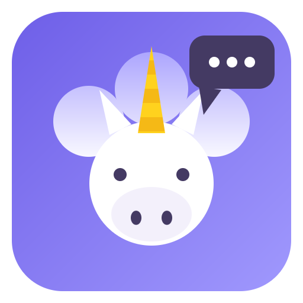

<p align="center">
  
</p>

<h1 align="center">UniChat</h1>

<p align="center">
  <strong>Todos tus chats de IA en una sola aplicación.</strong>
</p>

<p align="center">
  
  
  
  
  
</p>

<p align="center">
  <a href="README.md">English</a> &nbsp;·&nbsp;
  <a href="README.fr.md">Français</a> &nbsp;·&nbsp;
  <a href="README.de.md">Deutsch</a> &nbsp;·&nbsp;
  <strong>Español</strong> &nbsp;·&nbsp;
  <a href="README.it.md">Italiano</a>
</p>

<p align="center">
  <strong>Descarga:</strong>
  <a href="https://github.com/Invenify/Unichat/releases">Releases</a>
</p>

---

## El concepto

Usas ChatGPT, Claude, Gemini, Le Chat, Copilot… cada uno en su pestaña, su
ventana o su aplicación. **UniChat los reúne en una sola interfaz**: cada
servicio se abre en su propia vista (sesión persistida) y todas tus
conversaciones aparecen en una barra lateral unificada.

La regla de oro del proyecto: **cero código específico por servicio**. ¿Aparece
mañana un chat de IA desconocido? Pega su URL y funciona de inmediato.

## Descargar

Binarios listos para instalar en la [página de releases](https://github.com/Invenify/Unichat/releases):

| Plataforma | Archivo |
|---|---|
| Windows x64 | `UniChat Setup 0.2.0.exe` |
| Linux x64 | `UniChat-0.2.0.AppImage` |
| macOS arm64 | `UniChat-0.2.0-arm64-mac.zip` (sin firmar: clic derecho → Abrir en el primer inicio) |
| Android | `UniChat-0.2.0.apk` (build de depuración: permitir orígenes desconocidos) |

## Funcionalidades

| | Funcionalidad |
|---|---|
| **Registro dinámico** | Pega la URL de un chat de IA: la aplicación obtiene automáticamente su nombre, logotipo (favicon) y colores (theme-color, manifiesto) — todo editable antes de guardar. |
| **Motor de títulos universal** | En cada navegación la app registra `{servicio, url, título de la página, fecha}`. La barra lateral se construye a partir de este historial — ningún selector CSS que mantener, el título de la página ES el título del chat. |
| **Catálogo integrado** | 20 servicios conocidos (ChatGPT, Claude, Gemini, Copilot, Duck.ai, Perplexity, Le Chat, Grok, DeepSeek, Euria, Lumo, Poe, Qwen, Kimi…) propuestos en el primer arranque, activables/desactivables en cualquier momento (sesión e historial conservados). |
| **Reenvío y batalla de IA** | Escribe tu prompt en UniChat (Ctrl/Cmd+P), elige una IA (reenvío) o varias (batalla). Para cada IA el prompt se **pega y se envía automáticamente** (Enter simulado) y, en cuanto la IA crea la conversación, la siguiente toma el relevo — cero acción humana. Repliegue de 10 s + botón ▶ si una IA se resiste. Biblioteca de prompts guardados. Cero selectores del sitio; el prompt nunca se lee desde las páginas. |
| **Pantalla dividida (escritorio)** | Dos IA lado a lado (Ctrl/Cmd+E, luego Ctrl+clic en un servicio para la mitad derecha): compara respuestas sin alternar. |
| **Espacios de trabajo** | Personal, trabajo, estudios…: cada espacio es un subconjunto de tus servicios — **cambio rápido mediante el chip** (barra lateral de escritorio, pantalla Chats móvil); la paleta, el reenvío, el dock y Ctrl/Cmd+1…9 siguen el espacio activo, y las IA fuera del espacio se ponen en reposo (escritorio). Creación y gestión en Ajustes; pertenencia vía el ✎ del servicio (escritorio) o el menú ⋮ (móvil). |
| **Multicuentas** | Duplica un servicio (✎ → «Duplicar»): conexión totalmente independiente (Le Chat personal + trabajo). |
| **Orden libre de los servicios** | Arrastra los encabezados de la barra lateral (escritorio) o el dock (móvil, pulsación larga) para ordenar tus IA — Euria y Euria Pro lado a lado. El orden también gobierna los atajos Ctrl/Cmd+1…9. |
| **Paleta universal** | Ctrl/Cmd+Tab: busca una conversación entre todos los servicios (o un servicio por nombre) y salta a ella con una tecla — sin recordar en qué sitio vive un chat. |
| **Perfil multidispositivo** | Exporta tus servicios, espacios, ajustes e historial a un archivo JSON (`unichat-profile.json`) — **nunca las sesiones**. Hoja de compartir de Android en móvil, diálogos nativos en escritorio. La importación fusiona sin sobrescribir nada; los ids se reasignan por URL. |
| **Recursos** | Ajuste de «hibernación»: las IA no mostradas durante X minutos se ponen en reposo (memoria liberada), se despiertan al hacer clic en su última página — sesión conservada. Nunca durante una batalla. |
| **Ajustes e idiomas** | Menú de Ajustes (⚙ o Ctrl/Cmd+,): tema, **idioma de la interfaz** (francés, inglés, alemán, español, italiano — sigue el idioma del sistema por defecto), **bloqueador de rastreadores** en las vistas (escritorio), **retención del historial** (ilimitado / 30 días / 90 días / 1 año), gestión de servicios, exportación/importación del registro. Escritorio y móvil. |
| **Atajos** | Ctrl/Cmd+1…9 servicio, +K buscar, +P reenvío/batalla, +N nuevo chat, +Tab paleta, +E pantalla dividida, +B barra lateral, +, ajustes, +/ la lista de atajos — y Ctrl/Cmd+Alt+U, un **atajo del sistema**: UniChat aparece sobre cualquier aplicación, con la paleta abierta. **Adjuntar un archivo** al prompt (texto, 128 KB) en el reenvío, escritorio y móvil. |
| **Tema** | Claro/oscuro, sigue al SO en tiempo real (las WebView también). |
| **Acabados** | Edición de un servicio (nombre, colores, logotipo, URL, exclusiones), eliminación con sesión conservada o borrada, barra de direcciones, exportación/importación del registro en JSON (fusión por URL). |

## Inicio rápido

```bash
npm install
npm start
```

| Comando | Descripción |
|---|---|
| `npm start` | Ejecutar la app de escritorio (Electron) |
| `npm test` | Pruebas de humo de escritorio + móvil (motor de títulos, registro, DOM) |
| `npm run icon` | Regenerar el logotipo del «unicornio que habla» (`build/icon.png`) |
| `npm run dist:linux` | Empaquetar AppImage de Linux |
| `npm run dist:win` | Empaquetar NSIS de Windows x64 |
| `npm run dist:mac` | Empaquetar DMG de macOS arm64 |

## Android (Capacitor)

La UI móvil vive en `mobile/` (HTML/CSS/JS, mismos tokens de tema que el
escritorio) y consume los mismos módulos de `src/shared/`. Tres pantallas
(Chats / Servicios / Ajustes), navegación inferior, bottom-sheets, tema que
sigue al SO o forzado. `mobile/api.js` aísla el almacenamiento (hoy
localStorage, luego APIs nativas).

```bash
npm run mobile         # esbuild: mobile/ -> www/ (bundle + logotipos)
npm run mobile:sync    # build + copia al proyecto android/
npm run mobile:open    # abrir android/ en Android Studio
```

## Arquitectura

```
src/
├── shared/                # Código portable, escritorio + Android (cero APIs Node/Electron)
│   ├── title-rules.js     # Reglas del motor de títulos (isChatUrl, cleanTitle, resolveTitle)
│   ├── catalog.js         # Catálogo declarativo de chats de IA conocidos
│   ├── service.js         # Modelo de servicio + fusión por URL (import/export)
│   ├── i18n.js            # Diccionario de la interfaz (fr/en/de/es/it)
│   ├── profile.js         # Perfil multidispositivo: esquema + fusión, reasignación de ids
│   └── trackers.js        # Lista conservadora de dominios de rastreo/publicidad
├── main/
│   ├── main.js            # Ventana, una WebContentsView por servicio, IPC
│   ├── registry.js        # Registro de servicios (services.json)
│   ├── workspaces.js      # Espacios de trabajo, subconjuntos con nombre de servicios
│   ├── metadata.js        # Análisis automático de URL: favicon, colores, título
│   └── settings.js        # Preferencias de la app (settings.json)
├── preload/preload.js     # Puente IPC (el i18n se expone aquí)
├── renderer/              # UI de escritorio (barra lateral, asistente, ajustes, paleta)
├── engine/
│   ├── title-tracker.js   # did-navigate / page-title-updated -> historial
│   └── conv-store.js      # Historial local (history.json, 100 % local)
└── recipes/               # OPCIONAL: selectores por servicio (nunca leídos)
```

## Datos y privacidad (100 % local)

| Archivo | Contenido |
|---|---|
| `userData/services.json` | Registro de servicios (id, nombre, url, colores, logotipo, enabled) |
| `userData/history.json` | Historial de chats visitados, deduplicado por (servicio, url) |
| `userData/workspaces.json` | Espacios de trabajo (subconjuntos con nombre de servicios) |
| `userData/settings.json` | Preferencias de la app |
| Particiones `persist:<id>` | Sesiones/cookies por servicio, conservadas entre arranques |

Ningún tráfico de red salvo hacia los propios servicios. Para un servicio
cifrado de extremo a extremo (Lumo), UniChat solo captura el título visible en
pantalla, en tu dispositivo. Las sesiones nunca forman parte de un perfil
exportado.

## Recetas opcionales

El motor de títulos no proporciona ni contadores de no leídos ni
conversaciones nunca abiertas. Para eso, deja un `recipes/<dominio>.json`:

```json
{
  "listSelector": "...",
  "itemSelector": "...",
  "titleSelector": "...",
  "linkSelector": "...",
  "unreadSelector": "..."
}
```

La app siempre funciona sin receta; busca los selectores manualmente con F12
(nunca los inventes).

---

## Licencia

MIT.
