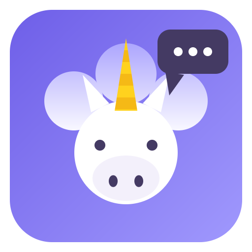

<p align="center">
  
</p>

<h1 align="center">UniChat</h1>

<p align="center">
  <strong>Tous vos chats IA dans une seule interface.</strong>
</p>

<p align="center">
  
  
  
  
  
</p>

<p align="center">
  <a href="README.md">English</a> &nbsp;·&nbsp;
  <strong>Français</strong> &nbsp;·&nbsp;
  <a href="README.de.md">Deutsch</a> &nbsp;·&nbsp;
  <a href="README.es.md">Español</a> &nbsp;·&nbsp;
  <a href="README.it.md">Italiano</a>
</p>

<p align="center">
  <strong>Téléchargez l'application :</strong>
  <a href="https://github.com/Invenify/Unichat/releases">Releases</a>
</p>

---

## Le concept

Vous utilisez ChatGPT, Claude, Gemini, Le Chat, Copilot… chacun dans son
onglet, sa fenêtre, son application. **UniChat les réunit tous dans une seule
interface** : chaque service s'ouvre dans sa propre vue (session conservée),
et toutes vos conversations remontent dans une sidebar unique.

La règle d'or du projet : **aucun code spécifique à un service**. Un chat IA
inconnu demain ? Collez son URL, il fonctionne immédiatement.

## Télécharger

Binaires prêts à installer sur la [page des releases](https://github.com/Invenify/Unichat/releases) :

| Plateforme | Fichier |
|---|---|
| Windows x64 | `UniChat Setup 0.2.0.exe` |
| Linux x64 | `UniChat-0.2.0.AppImage` |
| macOS arm64 | `UniChat-0.2.0-arm64-mac.zip` (non signé : clic droit → Ouvrir au premier lancement) |
| Android | `UniChat-0.2.0.apk` (build debug : autoriser les sources inconnues) |

## Fonctionnalités

| | Fonctionnalité |
|---|---|
| **Registre dynamique** | Collez l'URL d'un chat IA : l'app récupère automatiquement son nom, son logo (favicon) et ses couleurs (theme-color, manifest). Tout est modifiable avant enregistrement. |
| **Moteur de titres universel** | À chaque navigation, l'app enregistre `{service, url, titre de la page, date}`. La sidebar est construite à partir de cet historique — aucun sélecteur CSS à maintenir, le titre de la page EST le titre du chat. |
| **Catalogue intégré** | 20 services connus (ChatGPT, Claude, Gemini, Copilot, Duck.ai, Perplexity, Le Chat, Grok, DeepSeek, Euria, Lumo, Poe, Qwen, Kimi…) proposés au premier lancement, activables/désactivables à tout moment (session et historique conservés). |
| **Relais & battle d'IA** | Saisissez le prompt dans UniChat (Ctrl/Cmd+P), choisissez une IA (relais) ou plusieurs (battle). Pour chaque IA : le prompt est **collé puis envoyé automatiquement** (Entrée simulé), et dès que l'IA crée la conversation, la suivante prend le relais — zéro action humaine. Repli 10 s + bouton ▶ si une IA résiste. Bibliothèque de prompts mémorisés. Zéro sélecteur de site, le prompt n'est jamais lu depuis les pages. |
| **Écran partagé (desktop)** | Deux IA côte à côte (Ctrl/Cmd+E, puis Ctrl+clic sur un service pour la moitié droite) : comparez les réponses sans basculer. |
| **Espaces de travail** | Perso, pro, études… : chaque espace est un sous-ensemble de vos services — **bascule rapide par la chip** (sidebar desktop, écran Chats mobile) ; la palette, le relais, le dock et `Ctrl/Cmd+1…9` suivent l'espace actif, et les IA hors espace sont mises en veille (desktop). Création et gestion dans les Réglages, appartenance via le ✎ du service (desktop) ou le menu ⋮ (mobile). |
| **Multi-comptes** | Dupliquez un service (✎ → « Dupliquer ») : connexion totalement indépendante (Le Chat perso + pro). |
| **Ordre libre des services** | Glissez les en-têtes de la sidebar (desktop) ou le dock (mobile, appui long) pour ranger vos IA — Euria et Euria Pro côte à côte. L'ordre pilote aussi les raccourcis `Ctrl/Cmd+1…9`. |
| **Palette universelle** | `Ctrl/Cmd+Tab` : cherchez une conversation parmi tous les services (ou un service par son nom) et y aller d'une touche — plus besoin de se souvenir de « sur quel site » vit un chat. |
| **Profil multi-appareil** | Exportez vers un fichier JSON (`unichat-profile.json`) vos services, espaces, réglages et historique — **jamais les sessions**. Partage Android sur mobile, dialogues natifs sur desktop. Import qui fusionne sans rien écraser, ids remappés par URL. |
| **Ressources** | Réglage « hibernation » : les IA non affichées depuis X minutes sont mises en veille (mémoire libérée), réveillées au clic sur leur dernière page — session conservée. Jamais pendant un battle. |
| **Réglages & langues** | Menu Réglages (⚙ ou Ctrl/Cmd+,) : thème, **langue de l'interface** (français, anglais, allemand, espagnol, italien — suit la langue du système par défaut), **bloque-pisteurs** dans les vues (desktop), **rétention de l'historique** (illimité / 30 jours / 90 jours / 1 an), gestion des services, export/import du registre. Desktop et mobile. |
| **Raccourcis** | `Ctrl/Cmd+1…9` service, `+K` chercher, `+P` relais/battle, `+N` nouveau chat, `+Tab` palette, `+E` écran partagé, `+B` sidebar, `+,` réglages, `+/` la liste des raccourcis — et `Ctrl/Cmd+Alt+U`, **raccourci système** : UniChat surgit par-dessus toute application, palette ouverte. **Joindre un fichier** au prompt (texte, 128 Ko) dans le relais, desktop et mobile. |
| **Thème** | Clair/sombre, suit l'OS en temps réel (les WebViews suivent). |
| **Finitions** | Édition d'un service (nom, couleurs, logo, URL, exclusions), suppression avec session conservable ou déconnectée, barre d'adresse, export/import du registre en JSON (fusion par URL). |

## Démarrage rapide

```bash
npm install
npm start
```

| Commande | Description |
|---|---|
| `npm start` | Lancer l'app desktop (Electron) |
| `npm test` | Smoke tests desktop + mobile (moteur de titres, registre, DOM) |
| `npm run icon` | Régénérer le logo « licorne qui parle » (`build/icon.png`) |
| `npm run dist:linux` | Packaging AppImage Linux |
| `npm run dist:win` | Packaging NSIS Windows x64 |
| `npm run dist:mac` | Packaging DMG Mac arm64 |

## Android (Capacitor)

L'UI mobile vit dans `mobile/` (HTML/CSS/JS, mêmes tokens de thème que le
desktop) et consomme les mêmes modules `src/shared/`. Trois écrans
(Chats / Services / Réglages), navigation basse, bottom-sheets, thème suivant
l'OS ou forcé. `mobile/api.js` isole le stockage (localStorage aujourd'hui,
APIs natives ensuite).

```bash
npm run mobile         # esbuild : mobile/ -> www/ (bundle + logos)
npm run mobile:sync    # build + copie dans le projet android/
npm run mobile:open    # ouvrir android/ dans Android Studio
```

## Architecture

```
src/
├── shared/                # Code portable desktop + Android (zéro API Node/Electron)
│   ├── title-rules.js     # Règles du moteur de titres (isChatUrl, cleanTitle, resolveTitle)
│   ├── catalog.js         # Catalogue déclaratif des chats IA connus
│   ├── service.js         # Modèle d'un service + fusion par URL (import/export)
│   ├── i18n.js            # Dictionnaire de l'interface (fr/en/de/es/it)
│   ├── profile.js         # Profil multi-appareil : schéma + fusion, remappage des ids
│   └── trackers.js        # Liste conservatrice de domaines pisteurs/publicitaires
├── main/
│   ├── main.js            # Fenêtre, WebContentsView par service, IPC
│   ├── registry.js        # Registre de services (services.json)
│   ├── workspaces.js      # Espaces de travail, sous-ensembles nommés de services
│   ├── metadata.js        # Analyse auto d'une URL : favicon, couleurs, titre
│   └── settings.js        # Préférences de l'app (settings.json)
├── preload/preload.js     # Pont IPC (l'i18n y est exposée)
├── renderer/              # UI desktop (sidebar, wizard, réglages, palette)
├── engine/
│   ├── title-tracker.js   # did-navigate / page-title-updated -> historique
│   └── conv-store.js      # Historique local (history.json, 100 % local)
└── recipes/               # OPTIONNEL : sélecteurs par service (non-lus)
```

## Données et vie privée (100 % local)

| Fichier | Contenu |
|---|---|
| `userData/services.json` | Registre des services (id, nom, url, couleurs, logo, enabled) |
| `userData/history.json` | Historique des chats visités, dédoublonné par (service, url) |
| `userData/workspaces.json` | Espaces de travail (sous-ensembles nommés de services) |
| `userData/settings.json` | Préférences de l'app |
| Partitions `persist:<id>` | Sessions/cookies par service, conservées entre lancements |

Aucun envoi réseau autre que vers les services eux-mêmes. Pour un service
chiffré de bout en bout (Lumo), UniChat ne capture que le titre affiché à
l'écran, sur votre appareil. Les sessions ne font jamais partie d'un profil
exporté.

## Recettes optionnelles

Le moteur de titres ne donne ni les non-lus ni les conversations jamais
ouvertes. Pour cela, déposez `recipes/<domaine>.json` :

```json
{
  "listSelector": "...",
  "itemSelector": "...",
  "titleSelector": "...",
  "linkSelector": "...",
  "unreadSelector": "..."
}
```

L'app fonctionne toujours sans recette ; les sélecteurs se trouvent à la main
via F12 (ne jamais les inventer).

---

## Licence

MIT.
