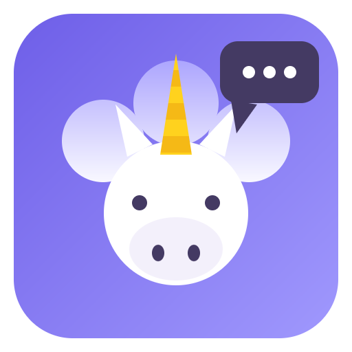

<p align="center">
  
</p>

<h1 align="center">UniChat</h1>

<p align="center">
  <strong>Tutte le tue chat IA in un'unica applicazione.</strong>
</p>

<p align="center">
  
  
  
  
  
</p>

<p align="center">
  <a href="README.md">English</a> &nbsp;·&nbsp;
  <a href="README.fr.md">Français</a> &nbsp;·&nbsp;
  <a href="README.de.md">Deutsch</a> &nbsp;·&nbsp;
  <a href="README.es.md">Español</a> &nbsp;·&nbsp;
  <strong>Italiano</strong>
</p>

<p align="center">
  <strong>Scarica:</strong>
  <a href="https://github.com/Invenify/Unichat/releases">Releases</a>
</p>

---

## Il concetto

Usi ChatGPT, Claude, Gemini, Le Chat, Copilot… ognuno nella sua scheda,
finestra o applicazione. **UniChat li riunisce in un'unica interfaccia**:
ogni servizio si apre nella sua vista (sessione conservata) e tutte le tue
conversazioni compaiono in un'unica barra laterale.

La regola d'oro del progetto: **zero codice specifico per servizio**. Domani
spunta una chat IA sconosciuta? Incolla la sua URL e funziona subito.

## Scaricare

Binari pronti da installare sulla [pagina delle release](https://github.com/Invenify/Unichat/releases):

| Piattaforma | File |
|---|---|
| Windows x64 | `UniChat Setup 0.2.0.exe` |
| Linux x64 | `UniChat-0.2.0.AppImage` |
| macOS arm64 | `UniChat-0.2.0-arm64-mac.zip` (non firmato: clic destro → Apri al primo avvio) |
| Android | `UniChat-0.2.0.apk` (build di debug: consentire le origini sconosciute) |

## Funzionalità

| | Funzionalità |
|---|---|
| **Registro dinamico** | Incolla l'URL di una chat IA: l'app recupera automaticamente nome, logo (favicon) e colori (theme-color, manifest) — tutto modificabile prima di salvare. |
| **Motore di titoli universale** | A ogni navigazione l'app registra `{servizio, url, titolo della pagina, data}`. La barra laterale è costruita da questa cronologia — nessun selettore CSS da mantenere, il titolo della pagina È il titolo della chat. |
| **Catalogo integrato** | 20 servizi noti (ChatGPT, Claude, Gemini, Copilot, Duck.ai, Perplexity, Le Chat, Grok, DeepSeek, Euria, Lumo, Poe, Qwen, Kimi…) proposti al primo avvio, attivabili/disattivabili in ogni momento (sessione e cronologia conservate). |
| **Inoltro e battaglia IA** | Scrivi il prompt in UniChat (Ctrl/Cmd+P), scegli un'IA (inoltro) o più di una (battaglia). Per ogni IA il prompt viene **incollato e inviato automaticamente** (Invio simulato) e, appena l'IA avvia la conversazione, la successiva prende il sopravvento — zero azioni umane. Ripiego di 10 s + pulsante ▶ se un'IA resiste. Libreria di prompt salvati. Zero selettori dei siti; il prompt non viene mai letto dalle pagine. |
| **Schermo diviso (desktop)** | Due IA affiancate (Ctrl/Cmd+E, poi Ctrl+clic su un servizio per la metà destra): confronta le risposte senza passare dall'una all'altra. |
| **Aree di lavoro** | Personale, lavoro, studio…: ogni area è un sottoinsieme dei tuoi servizi — **cambio rapido tramite il chip** (barra laterale desktop, schermata Chat su mobile); la palette, l'inoltro, il dock e Ctrl/Cmd+1…9 seguono l'area attiva, e le IA fuori area vengono messe in pausa (desktop). Creazione e gestione nelle Impostazioni; appartenenza tramite il ✎ del servizio (desktop) o il menu ⋮ (mobile). |
| **Multi-account** | Duplica un servizio (✎ → «Duplica»): accesso totalmente indipendente (Le Chat personale + lavoro). |
| **Ordine libero dei servizi** | Trascina le intestazioni della barra laterale (desktop) o il dock (mobile, pressione lunga) per sistemare le tue IA — Euria ed Euria Pro affiancate. L'ordine governa anche le scorciatoie Ctrl/Cmd+1…9. |
| **Palette universale** | Ctrl/Cmd+Tab: cerca una conversazione tra tutti i servizi (o un servizio per nome) e aprila con un tasto — senza ricordarti su quale sito vive una chat. |
| **Profilo multi-dispositivo** | Esporta servizi, aree, impostazioni e cronologia in un file JSON (`unichat-profile.json`) — **mai le sessioni**. Condivisione Android su mobile, finestre native su desktop. L'importazione unisce senza sovrascrivere nulla; gli id vengono rimappati per URL. |
| **Risorse** | Impostazione «pausa»: le IA non visualizzate da X minuti vengono messe in pausa (memoria liberata), riattivate al clic sulla loro ultima pagina — sessione conservata. Mai durante una battaglia. |
| **Impostazioni e lingue** | Menu Impostazioni (⚙ o Ctrl/Cmd+,): tema, **lingua dell'interfaccia** (francese, inglese, tedesco, spagnolo, italiano — segue la lingua di sistema per impostazione predefinita), **blocca-tracker** nelle viste (desktop), **conservazione della cronologia** (illimitata / 30 giorni / 90 giorni / 1 anno), gestione dei servizi, esportazione/importazione del registro. Desktop e mobile. |
| **Scorciatoie** | Ctrl/Cmd+1…9 servizio, +K cerca, +P inoltro/battaglia, +N nuova chat, +Tab palette, +E schermo diviso, +B barra laterale, +, impostazioni, +/ l'elenco delle scorciatoie — e Ctrl/Cmd+Alt+U, una **scorciatoia di sistema**: UniChat appare sopra qualsiasi applicazione, con la palette aperta. **Allega un file** al prompt (testo, 128 KB) nell'inoltro, desktop e mobile. |
| **Tema** | Chiaro/scuro, segue il sistema operativo in tempo reale (le WebView seguono). |
| **Dettagli** | Modifica di un servizio (nome, colori, logo, URL, esclusioni), rimozione con sessione conservata o cancellata, barra degli indirizzi, esportazione/importazione del registro in JSON (fusione per URL). |

## Avvio rapido

```bash
npm install
npm start
```

| Comando | Descrizione |
|---|---|
| `npm start` | Avvia l'app desktop (Electron) |
| `npm test` | Smoke test desktop + mobile (motore di titoli, registro, DOM) |
| `npm run icon` | Rigenera il logo «unicorno che parla» (`build/icon.png`) |
| `npm run dist:linux` | Pacchettizza AppImage Linux |
| `npm run dist:win` | Pacchettizza NSIS Windows x64 |
| `npm run dist:mac` | Pacchettizza DMG macOS arm64 |

## Android (Capacitor)

La UI mobile vive in `mobile/` (HTML/CSS/JS, stessi token di tema del desktop)
e usa gli stessi moduli `src/shared/`. Tre schermate (Chat / Servizi /
Impostazioni), navigazione in basso, bottom-sheet, tema che segue il sistema
o forzato. `mobile/api.js` isola l'archiviazione (oggi localStorage, poi API
native).

```bash
npm run mobile         # esbuild: mobile/ -> www/ (bundle + loghi)
npm run mobile:sync    # build + copia nel progetto android/
npm run mobile:open    # apri android/ in Android Studio
```

## Architettura

```
src/
├── shared/                # Codice portabile, desktop + Android (zero API Node/Electron)
│   ├── title-rules.js     # Regole del motore di titoli (isChatUrl, cleanTitle, resolveTitle)
│   ├── catalog.js         # Catalogo dichiarativo delle chat IA note
│   ├── service.js         # Modello di servizio + fusione per URL (import/export)
│   ├── i18n.js            # Dizionario dell'interfaccia (fr/en/de/es/it)
│   ├── profile.js         # Profilo multi-dispositivo: schema + fusione, rimappatura degli id
│   └── trackers.js        # Lista conservativa di domini tracker/pubblicità
├── main/
│   ├── main.js            # Finestra, una WebContentsView per servizio, IPC
│   ├── registry.js        # Registro dei servizi (services.json)
│   ├── workspaces.js      # Aree di lavoro, sottoinsiemi di servizi con nome
│   ├── metadata.js        # Analisi automatica dell'URL: favicon, colori, titolo
│   └── settings.js        # Preferenze dell'app (settings.json)
├── preload/preload.js     # Ponte IPC (l'i18n è esposta qui)
├── renderer/              # UI desktop (barra laterale, procedura guidata, impostazioni, palette)
├── engine/
│   ├── title-tracker.js   # did-navigate / page-title-updated -> cronologia
│   └── conv-store.js      # Cronologia locale (history.json, 100 % locale)
└── recipes/               # OPZIONALE: selettori per servizio (mai letti)
```

## Dati e privacy (100 % locale)

| File | Contenuto |
|---|---|
| `userData/services.json` | Registro dei servizi (id, nome, url, colori, logo, enabled) |
| `userData/history.json` | Cronologia delle chat visitate, deduplicata per (servizio, url) |
| `userData/workspaces.json` | Aree di lavoro (sottoinsiemi di servizi con nome) |
| `userData/settings.json` | Preferenze dell'app |
| Partizioni `persist:<id>` | Sessioni/cookie per servizio, conservate tra gli avvii |

Nessun traffico di rete verso altri se non i servizi stessi. Per un servizio
crittografato end-to-end (Lumo), UniChat cattura solo il titolo a schermo, sul
tuo dispositivo. Le sessioni non fanno mai parte di un profilo esportato.

## Ricette opzionali

Il motore di titoli non fornisce né i contatori dei non letti né le
conversazioni mai aperte. Per quelli, aggiungi un `recipes/<dominio>.json`:

```json
{
  "listSelector": "...",
  "itemSelector": "...",
  "titleSelector": "...",
  "linkSelector": "...",
  "unreadSelector": "..."
}
```

L'app funziona sempre senza ricetta; trova i selettori manualmente con F12
(non inventarli mai).

---

## Licenza

MIT.
