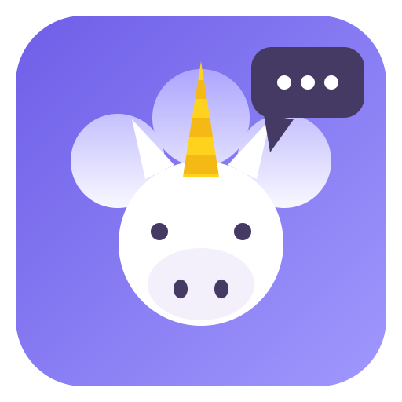

<p align="center">
  
</p>

<h1 align="center">UniChat</h1>

<p align="center">
  <strong>All your AI chats in a single app.</strong>
</p>

<p align="center">
  
  
  
  
  
</p>

<p align="center">
  <strong>English</strong> &nbsp;·&nbsp;
  <a href="README.fr.md">Français</a> &nbsp;·&nbsp;
  <a href="README.de.md">Deutsch</a> &nbsp;·&nbsp;
  <a href="README.es.md">Español</a> &nbsp;·&nbsp;
  <a href="README.it.md">Italiano</a>
</p>

<p align="center">
  <strong>Download:</strong>
  <a href="https://github.com/Invenify/Unichat/releases">Releases</a>
</p>

---

## The concept

You use ChatGPT, Claude, Gemini, Le Chat, Copilot… each in its own tab,
window, or app. **UniChat brings them all into a single interface**: every
service opens in its own view (session persisted), and all your conversations
surface in one unified sidebar.

The project's golden rule: **zero service-specific code**. An unknown AI chat
shows up tomorrow? Paste its URL, it just works.

## Download

Ready-to-install binaries on the [releases page](https://github.com/Invenify/Unichat/releases):

| Platform | File |
|---|---|
| Windows x64 | `UniChat Setup 0.2.0.exe` |
| Linux x64 | `UniChat-0.2.0.AppImage` |
| macOS arm64 | `UniChat-0.2.0-arm64-mac.zip` (unsigned: right-click → Open on first launch) |
| Android | `UniChat-0.2.0.apk` (debug build: allow unknown sources) |

## Features

| | Feature |
|---|---|
| **Dynamic registry** | Paste an AI chat URL: the app automatically fetches its name, logo (favicon) and colors (theme-color, manifest) — all editable before saving. |
| **Universal title engine** | On every navigation the app records `{service, url, page title, date}`. The sidebar is built from this history — no CSS selector to maintain, the page title IS the chat title. |
| **Built-in catalog** | 20 known services (ChatGPT, Claude, Gemini, Copilot, Duck.ai, Perplexity, Le Chat, Grok, DeepSeek, Euria, Lumo, Poe, Qwen, Kimi…) offered on first launch, toggleable anytime (session and history preserved). |
| **Relay & AI battle** | Type your prompt in UniChat (`Ctrl/Cmd+P`), pick one AI (relay) or several (battle). For each AI the prompt is **pasted then sent automatically** (simulated Enter), and as soon as the AI starts the conversation, the next one takes over — zero human action. 10 s fallback + ▶ button if an AI resists. Saved-prompt library. Zero site selectors; the prompt is never read from the pages. |
| **Split view (desktop)** | Two AIs side by side (`Ctrl/Cmd+E`, then Ctrl+click a service for the right half): compare answers without switching. |
| **Workspaces** | Personal, work, study…: each workspace is a subset of your services — **fast switching via the chip** (desktop sidebar, mobile Chats screen); the palette, relay, dock and `Ctrl/Cmd+1…9` follow the active workspace, and out-of-workspace AIs are put to sleep (desktop). Creation and management in Settings; membership via the service's ✎ (desktop) or ⋮ menu (mobile). |
| **Multi-accounts** | Duplicate a service (✎ → “Duplicate”): fully independent login (Le Chat personal + work). |
| **Free service ordering** | Drag the sidebar headers (desktop) or the dock (mobile, long-press) to arrange your AIs — Euria and Euria Pro side by side. The order also drives the `Ctrl/Cmd+1…9` shortcuts. |
| **Universal palette** | `Ctrl/Cmd+Tab`: search a conversation across all services (or a service by name) and jump to it in one keystroke — no need to remember which site a chat lives on. |
| **Multi-device profile** | Export your services, workspaces, settings and history to a JSON file (`unichat-profile.json`) — **never your sessions**. Android share sheet on mobile, native dialogs on desktop. Import merges without overwriting anything; ids are remapped by URL. |
| **Resources** | “Hibernate” setting: AIs not shown for X minutes are put to sleep (memory freed), woken on click on their last page — session kept. Never during a battle. |
| **Settings & languages** | Settings menu (⚙ or `Ctrl/Cmd+,`): theme, **interface language** (French, English, German, Spanish, Italian — follows the system language by default), **tracker blocker** in the views (desktop), **history retention** (unlimited / 30 days / 90 days / 1 year), service management, registry export/import. Desktop and mobile. |
| **Shortcuts** | `Ctrl/Cmd+1…9` service, `+K` search, `+P` relay/battle, `+N` new chat, `+Tab` palette, `+E` split view, `+B` sidebar, `+,` settings, `+/` the shortcut list — and `Ctrl/Cmd+Alt+U`, a **system-wide shortcut**: UniChat pops above any application, palette open. **Attach a file** to the prompt (text, 128 KB) in the relay, desktop and mobile. |
| **Theme** | Light/dark, follows the OS live (WebViews follow too). |
| **Finishing touches** | Service editing (name, colors, logo, URL, exclusions), removal with session kept or wiped, address bar, JSON registry export/import (merged by URL). |

## Quick start

```bash
npm install
npm start
```

| Command | Description |
|---|---|
| `npm start` | Run the desktop app (Electron) |
| `npm test` | Desktop + mobile smoke tests (title engine, registry, DOM) |
| `npm run icon` | Regenerate the "talking unicorn" logo (`build/icon.png`) |
| `npm run dist:linux` | Package Linux AppImage |
| `npm run dist:win` | Package Windows NSIS x64 |
| `npm run dist:mac` | Package macOS DMG arm64 |

## Android (Capacitor)

The mobile UI lives in `mobile/` (HTML/CSS/JS, same theme tokens as desktop)
and consumes the same `src/shared/` modules. Three screens (Chats / Services /
Settings), bottom navigation, bottom sheets, OS-following or forced theme.
`mobile/api.js` isolates storage (localStorage today, native APIs later).

```bash
npm run mobile         # esbuild: mobile/ -> www/ (bundle + logos)
npm run mobile:sync    # build + copy into the android/ project
npm run mobile:open    # open android/ in Android Studio
```

## Architecture

```
src/
├── shared/                # Portable code, desktop + Android (zero Node/Electron APIs)
│   ├── title-rules.js     # Title engine rules (isChatUrl, cleanTitle, resolveTitle)
│   ├── catalog.js         # Declarative catalog of known AI chats
│   ├── service.js         # Service model + URL-based merge (import/export)
│   ├── i18n.js            # UI dictionary (fr/en/de/es/it)
│   ├── profile.js         # Multi-device profile: schema + merge, id remapping
│   └── trackers.js        # Conservative tracker/ad domain list
├── main/
│   ├── main.js            # Window, one WebContentsView per service, IPC
│   ├── registry.js        # Service registry (services.json)
│   ├── workspaces.js      # Workspaces, named subsets of services
│   ├── metadata.js        # Auto URL analysis: favicon, colors, title
│   └── settings.js        # App preferences (settings.json)
├── preload/preload.js     # IPC bridge (i18n exposed here)
├── renderer/              # Desktop UI (sidebar, wizard, settings, palette)
├── engine/
│   ├── title-tracker.js   # did-navigate / page-title-updated -> history
│   └── conv-store.js      # Local history (history.json, 100% local)
└── recipes/               # OPTIONAL: per-service selectors (never read by default)
```

## Data & privacy (100% local)

| File | Content |
|---|---|
| `userData/services.json` | Service registry (id, name, url, colors, logo, enabled) |
| `userData/history.json` | Visited chat history, deduplicated by (service, url) |
| `userData/workspaces.json` | Workspaces (named subsets of services) |
| `userData/settings.json` | App preferences |
| `persist:<id>` partitions | Per-service sessions/cookies, kept across launches |

No network traffic other than to the services themselves. For an end-to-end
encrypted service (Lumo), UniChat only captures the on-screen title, on your
device. Sessions are never part of an exported profile.

## Optional recipes

The title engine provides neither unread counts nor never-opened
conversations. For those, drop a `recipes/<domain>.json`:

```json
{
  "listSelector": "...",
  "itemSelector": "...",
  "titleSelector": "...",
  "linkSelector": "...",
  "unreadSelector": "..."
}
```

The app always works without a recipe; find selectors manually via F12
(never invent them).

---

## License

MIT.
