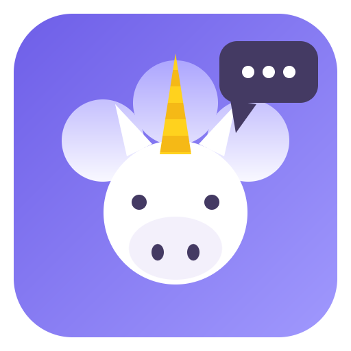

<p align="center">
  
</p>

<h1 align="center">UniChat</h1>

<p align="center">
  <strong>Tous vos chats IA dans une seule interface.</strong><br/>
  <em>All your AI chats in a single app.</em>
</p>

<p align="center">
  <a href="https://github.com/Invenify/Unichat/releases"></a>
  
  
  
  
</p>

<p align="center">
  <a href="#français">Français</a> &nbsp;·&nbsp;
  <a href="#english">English</a>
</p>

---

## Français

### Le concept

Vous utilisez ChatGPT, Claude, Gemini, Le Chat, Copilot… chacun dans son
onglet, sa fenêtre, son application. **UniChat les réunit tous dans une seule
interface** : chaque service s'ouvre dans sa propre vue (session conservée),
et toutes vos conversations remontent dans une sidebar unique.

La règle d'or du projet : **aucun code spécifique à un service**. Un chat IA
inconnu demain ? Collez son URL, il fonctionne immédiatement.

### Fonctionnalités

| | Fonctionnalité |
|---|---|
| **Registre dynamique** | Collez l'URL d'un chat IA : l'app récupère automatiquement son nom, son logo (favicon) et ses couleurs (theme-color, manifest). Tout est modifiable avant enregistrement. |
| **Moteur de titres universel** | À chaque navigation, l'app enregistre `{service, url, titre de la page, date}`. La sidebar est construite à partir de cet historique — aucun sélecteur CSS à maintenir, le titre de la page EST le titre du chat. |
| **Catalogue intégré** | 19 services connus (ChatGPT, Claude, Gemini, Copilot, Perplexity, Le Chat, Grok, DeepSeek, Euria, Lumo, Poe, Qwen, Kimi…) proposés au premier lancement, activables/désactivables à tout moment (session et historique conservés). |
| **Finitions** | Édition d'un service (nom, couleurs, logo, URL, exclusions), suppression avec session conservable ou déconnectée, barre d'adresse, export/import du registre en JSON (fusion par URL). |
| **Raccourcis** | `Ctrl/Cmd+1…9` pour basculer de service, `Ctrl/Cmd+K` pour chercher une conversation. |
| **Thème** | Clair/sombre, suit l'OS en temps réel (les WebViews suivent). |

### Démarrage rapide

```bash
npm install
npm start
```

| Commande | Description |
|---|---|
| `npm start` | Lancer l'app desktop (Electron) |
| `npm test` | Smoke tests desktop + mobile (moteur de titres, registre, DOM) |
| `npm run icon` | Régénérer le logo « licorne qui parle » (`build/icon.png`) |
| `npm run dist:linux` | Packaging AppImage Linux |
| `npm run dist:win` | Packaging NSIS Windows x64 |
| `npm run dist:mac` | Packaging DMG Mac arm64 |

### Android (Capacitor)

L'UI mobile vit dans `mobile/` (HTML/CSS/JS, mêmes tokens de thème que le
desktop) et consomme les mêmes modules `src/shared/`. Trois écrans
(Chats / Services / Réglages), navigation basse, bottom-sheets, thème suivant
l'OS ou forcé. `mobile/api.js` isole le stockage (localStorage aujourd'hui,
APIs natives ensuite).

```bash
npm run mobile         # esbuild : mobile/ -> www/ (bundle + logos)
npm run mobile:sync    # build + copie dans le projet android/
npm run mobile:open    # ouvrir android/ dans Android Studio
```

### Architecture

```
src/
├── shared/                # Code portable desktop + Android (zéro API Node/Electron)
│   ├── title-rules.js     # isChatUrl, cleanTitle — le cœur du moteur de titres
│   ├── catalog.js         # Catalogue déclaratif des chats IA connus
│   └── service.js         # Modèle d'un service + fusion par URL (import/export)
├── main/
│   ├── main.js            # Fenêtre, WebContentsView par service, IPC
│   ├── registry.js        # Registre de services (services.json)
│   ├── metadata.js        # Analyse auto d'une URL : favicon, couleurs, titre
│   └── settings.js        # Préférences de l'app
├── preload/preload.js     # Pont IPC
├── renderer/              # UI desktop (sidebar, wizard, catalogue)
├── engine/
│   ├── title-tracker.js   # did-navigate / page-title-updated -> historique
│   └── conv-store.js      # Historique local (history.json, 100 % local)
└── recipes/               # OPTIONNEL : sélecteurs par service (non-lus)
```

### Données et vie privée (100 % local)

| Fichier | Contenu |
|---|---|
| `userData/services.json` | Registre des services (id, nom, url, couleurs, logo, enabled) |
| `userData/history.json` | Historique des chats visités, dédoublonné par (service, url) |
| Partitions `persist:<id>` | Sessions/cookies par service, conservées entre lancements |

Aucun envoi réseau autre que vers les services eux-mêmes. Pour un service
chiffré de bout en bout (Lumo), UniChat ne capture que le titre affiché à
l'écran, sur votre appareil.

### Recettes optionnelles

Le moteur de titres ne donne ni les non-lus ni les conversations jamais
ouvertes. Pour cela, déposez `recipes/<domaine>.json` :

```json
{
  "listSelector": "...",
  "itemSelector": "...",
  "titleSelector": "...",
  "linkSelector": "...",
  "unreadSelector": "..."
}
```

L'app fonctionne toujours sans recette ; les sélecteurs se trouvent à la main
via F12 (ne jamais les inventer).

---

## English

### The concept

You use ChatGPT, Claude, Gemini, Le Chat, Copilot… each in its own tab,
window, or app. **UniChat brings them all into a single interface**: every
service opens in its own view (session persisted), and all your conversations
surface in one unified sidebar.

The project's golden rule: **zero service-specific code**. An unknown AI chat
shows up tomorrow? Paste its URL, it just works.

### Features

| | Feature |
|---|---|
| **Dynamic registry** | Paste an AI chat URL: the app automatically fetches its name, logo (favicon) and colors (theme-color, manifest) — all editable before saving. |
| **Universal title engine** | On every navigation the app records `{service, url, page title, date}`. The sidebar is built from this history — no CSS selector to maintain, the page title IS the chat title. |
| **Built-in catalog** | 19 known services (ChatGPT, Claude, Gemini, Copilot, Perplexity, Le Chat, Grok, DeepSeek, Euria, Lumo, Poe, Qwen, Kimi…) offered on first launch, toggleable anytime (session and history preserved). |
| **Finishing touches** | Service editing (name, colors, logo, URL, exclusions), removal with session kept or wiped, address bar, JSON registry export/import (merged by URL). |
| **Shortcuts** | `Ctrl/Cmd+1…9` to switch services, `Ctrl/Cmd+K` to search a conversation. |
| **Theme** | Light/dark, follows the OS live (WebViews follow too). |

### Quick start

```bash
npm install
npm start
```

| Command | Description |
|---|---|
| `npm start` | Run the desktop app (Electron) |
| `npm test` | Desktop + mobile smoke tests (title engine, registry, DOM) |
| `npm run icon` | Regenerate the "talking unicorn" logo (`build/icon.png`) |
| `npm run dist:linux` | Package Linux AppImage |
| `npm run dist:win` | Package Windows NSIS x64 |
| `npm run dist:mac` | Package macOS DMG arm64 |

### Android (Capacitor)

The mobile UI lives in `mobile/` (HTML/CSS/JS, same theme tokens as desktop)
and consumes the same `src/shared/` modules. Three screens (Chats / Services /
Settings), bottom navigation, bottom sheets, OS-following or forced theme.
`mobile/api.js` isolates storage (localStorage today, native APIs later).

```bash
npm run mobile         # esbuild: mobile/ -> www/ (bundle + logos)
npm run mobile:sync    # build + copy into the android/ project
npm run mobile:open    # open android/ in Android Studio
```

### Architecture

```
src/
├── shared/                # Portable code, desktop + Android (zero Node/Electron APIs)
│   ├── title-rules.js     # isChatUrl, cleanTitle — the heart of the title engine
│   ├── catalog.js         # Declarative catalog of known AI chats
│   └── service.js         # Service model + URL-based merge (import/export)
├── main/
│   ├── main.js            # Window, one WebContentsView per service, IPC
│   ├── registry.js        # Service registry (services.json)
│   ├── metadata.js        # Auto URL analysis: favicon, colors, title
│   └── settings.js        # App preferences
├── preload/preload.js     # IPC bridge
├── renderer/              # Desktop UI (sidebar, wizard, catalog)
├── engine/
│   ├── title-tracker.js   # did-navigate / page-title-updated -> history
│   └── conv-store.js      # Local history (history.json, 100% local)
└── recipes/               # OPTIONAL: per-service selectors (never read by default)
```

### Data & privacy (100% local)

| File | Content |
|---|---|
| `userData/services.json` | Service registry (id, name, url, colors, logo, enabled) |
| `userData/history.json` | Visited chat history, deduplicated by (service, url) |
| `persist:<id>` partitions | Per-service sessions/cookies, kept across launches |

No network traffic other than to the services themselves. For an end-to-end
encrypted service (Lumo), UniChat only captures the on-screen title, on your
device.

### Optional recipes

The title engine provides neither unread counts nor never-opened
conversations. For those, drop a `recipes/<domain>.json`:

```json
{
  "listSelector": "...",
  "itemSelector": "...",
  "titleSelector": "...",
  "linkSelector": "...",
  "unreadSelector": "..."
}
```

The app always works without a recipe; find selectors manually via F12
(never invent them).

---

## License

MIT.
